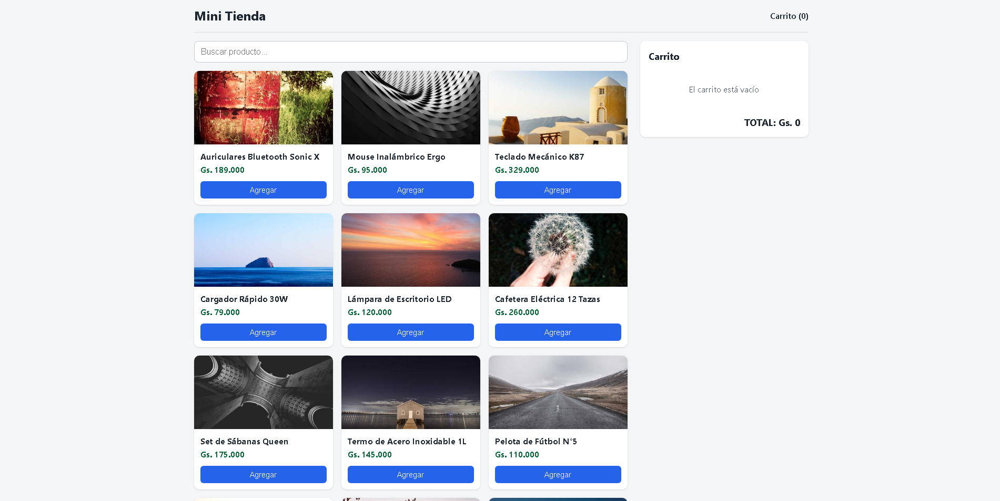
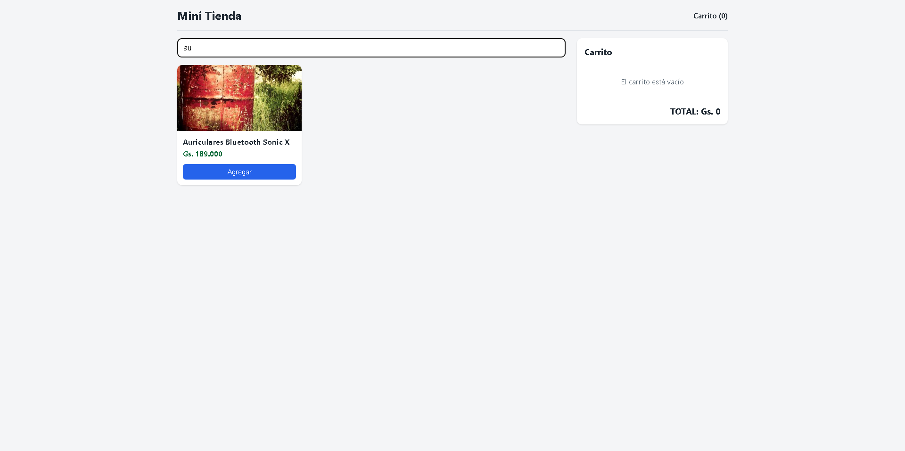
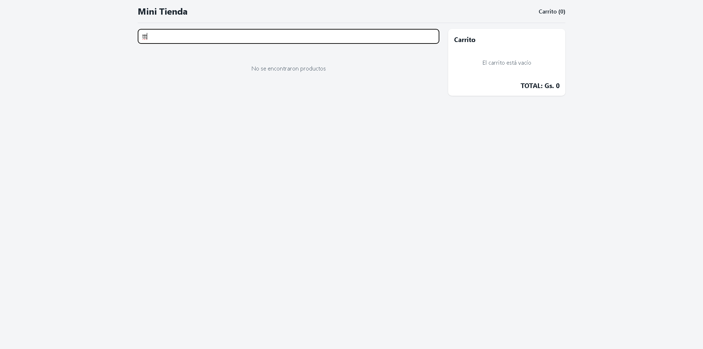
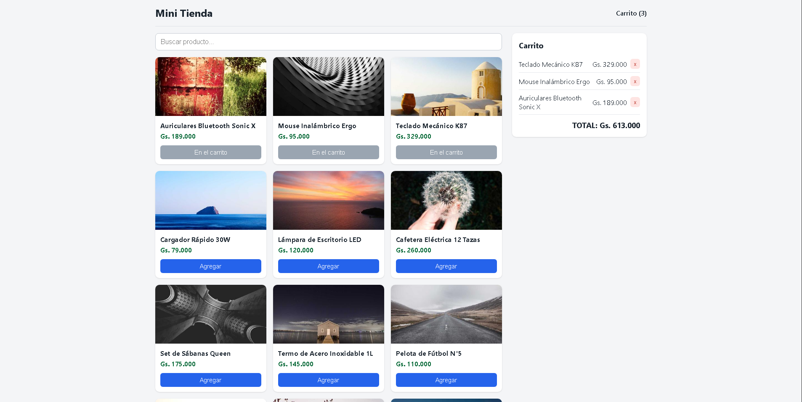

# Mini Tienda - (React + Vite)

Aplicación de comercio electrónico, desarrollada en equipo durante pasantia 2026. Este implementa consumo de API REST local, catálogo de productos con precios localizados en Guaraníes, buscador en tiempo real y gestión de carrito de compras.

## Requisitos previos

- **Node.js** (20 o superior)
- **npm**


## Para poner en marcha

Para ejecutar el proyecto en local se necesitan en simultáneo 2 terminales:

### 1. iniciar la API backend

En la primera terminal, levantá la base de datos simulada en el puerto `3001`:

```bash
npx json-server@0.17.4 db.json --port 3001
```

La API queda corriendo en http://localhost:3001/products.

### 2. Iniciar el Frontend

En la segunda terminal, instalá dependencias e iniciá el servidor:

```bash
npm install
npm run dev
```
La terminal muestra cierta dirección, usualmente `http://localhost:5173/`. Copiala y pegala en tu navegador, si no hay errores de conexión con la api deberia de mostrar los productos

## Scripts 

`npm run dev`: inicia el servidor en desarrollo local.
`npm run build`: compila la aplicación para producción en la carpeta `dist/`.
`npm run lint`: ejecuta ESLint para verificar la calidad y sintaxis del código.

## Capturas de pantalla

### Catálogo de productos


### Búsqueda en tiempo real


### Búsqueda sin resultados


### Carrito de compras



